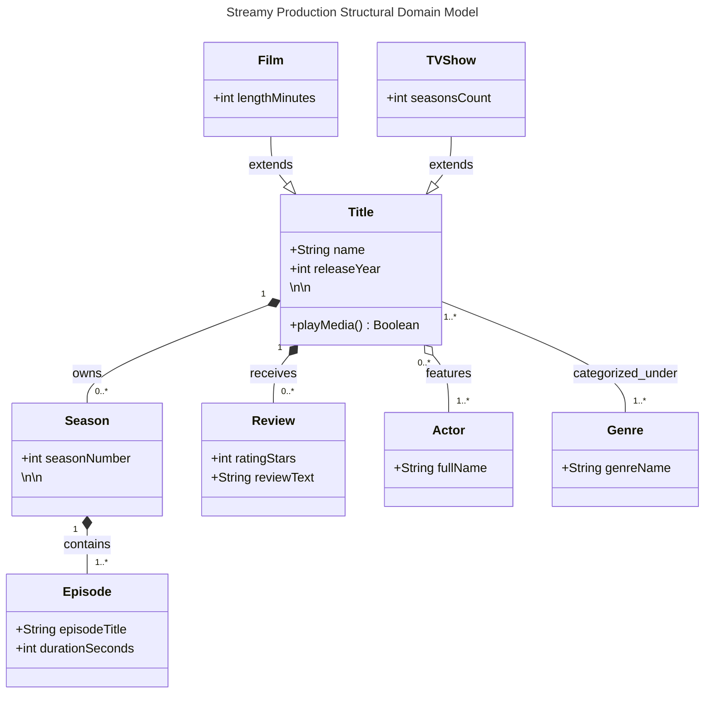
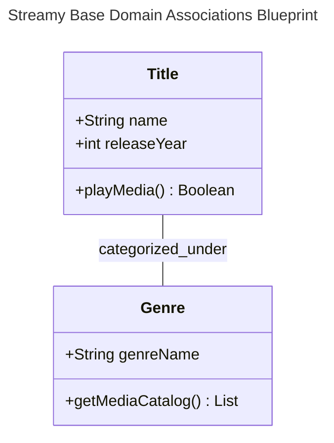

# Streamy Core Domain Structural Architecture
## Advanced Object-Oriented System Entity Specifications
### 1. Complex System Relationships Analysis
This structural document acts as the definitive blueprint for the Streamy runtime
system. It establishes core hierarchies, lifecycle coupling, and cardinality rules,
dictating how object models must inherit attributes and clear space allocations out
of memory.
### 2. Comprehensive Production Class Diagram
The advanced structural design schematic below details all inheritance, composition,
and aggregation parameters for the Streamy domain engine:

## Foundational Object-Oriented Entity Specifications

### 1. Conceptual Domain Breakdown
This tracking document establishes the baseline static structures for the Streamy streaming platform codebase. By translating system requirements nouns straight into unified class schemas, we guarantee the underlying database and Python structures align perfectly.

### 2. Base Entity Model Class Diagram
The architectural class schema below plots our primary data properties, encapsulation metrics, and loose directional system associations:

